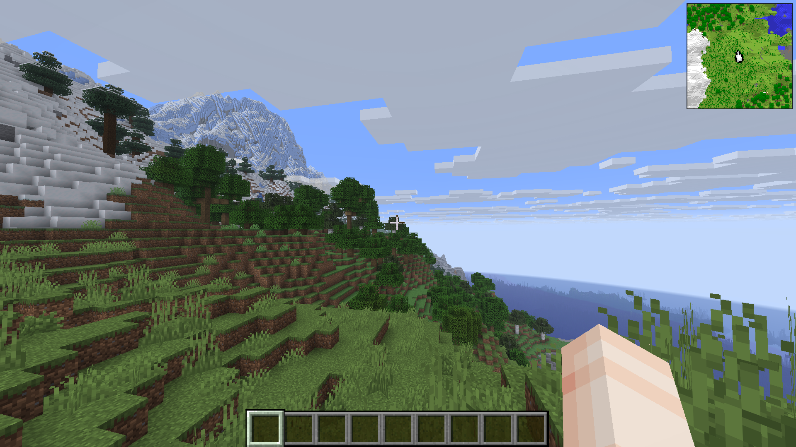

# Tectonic-Horizon

An unofficial native Rust port of [Tectonic](https://github.com/Apollounknowndev/tectonic) by Apollo (Apollounknowndev), based on Tectonic 3.0.1, revision `0761b561062de01b701d2571401f625c31059a9a`, released under CC0-1.0. Not made or endorsed by Apollo or the Horizon project.

Adds Tectonic's mountain ranges, terrain density recipes, underground rivers and configuration to Horizon 26.3. This is a source-only native mod: the launcher compiles it into a separate game. It runs with the game's account permissions. No Minecraft JARs, classes, assets or prepared resources are included.

The screenshot was supplied by the author and captured on 2026-11-01 in our Horizon fork; it illustrates terrain, not a compatibility test of the pinned upstream build. The minimap is a separate mod.

## Install and configure

Install the native mod through Horizon's launcher, then Build. Enable it under Options > Mods before opening a world. Rebuild and restart to use an updated package. On upstream, keep the same mod selection when reopening worlds to avoid terrain seams. Our fork additionally records mod selections per world.

Configuration: `config/tectonic-horizon.json` in the game home, or `TECTONIC_HORIZON_CONFIG`. See [the example](config.example.json) and [installation notes](docs/INSTALL.md). Missing fields use defaults; restart after edits. Changes affect newly generated chunks. Increased-height terrain must be selected before creating a world.

## Compatibility and limits

Version 0.3.1 pins upstream Horizon `0409f619a6a5529c7278306a49476eafb3913e8a` and Horizon Mixins `ddd9700b21997c95d95ac6ee5ecafe3830cf622a`; [compatibility.json](compatibility.json) records source hashes. Other revisions are not covered by this release's validation.

The original terrain definitions and config defaults are imported with provenance in [upstream.json](upstream.json) and [third-party notices](THIRD_PARTY_NOTICES.md). This port adapts noise/density schemas and aquifers to Horizon. It does not claim block-for-block Java parity. Native river decoration uses a chunk-local random stream and differs from Lithostitched's Java feature placement. The Java config screen and Terralith/CliffTree overlays are not included. Biome packs require their own Horizon ports; our fork's BOP compatibility is separate from upstream validation. Tectonic registers no keys and does not intercept keyboard input.

See [validation](docs/VALIDATION.md) for the release's checks and their scope. The public source and packaged mixins are identical; `python3 tools/package.py` reproduces the source-only `.hnmod`.

License: [CC0-1.0](LICENSE). Original Tectonic by Apollo; Horizon adaptation by eltanschauung with Codex assistance.
